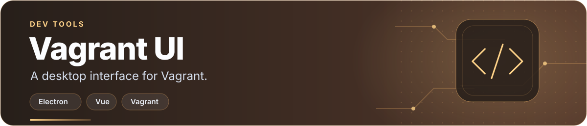

# 

An Electron and Vue application for browsing Vagrant boxes and managing local Vagrant workflows. The package is also named Vigger in the project files.

[](https://github.com/svazqz/vagrant-ui/actions/workflows/ci.yml)

[Quick start](#quick-start) · [Validation](#validation) · [Project layout](#project-layout) · [License](#license)

## Quick start

Use a Node.js environment compatible with the existing Electron and Vue toolchain, along with Vagrant for host operations.

```sh
npm ci
npm run start-dev
```

## Validation

```sh
npm run transpile
```

Launch the app locally to verify that Vagrant is available and the main window opens.

## Project layout

| Path | Purpose |
| --- | --- |
| [`src/electron/`](src/electron/) | Electron main process |
| [`src/modules/vagrant/`](src/modules/vagrant/) | Vagrant integration |
| [`src/views/`](src/views/) | Desktop screens |
| [`tests/`](tests/) | Test configuration and sources |

## License

See [`LICENSE`](LICENSE) for license terms.
